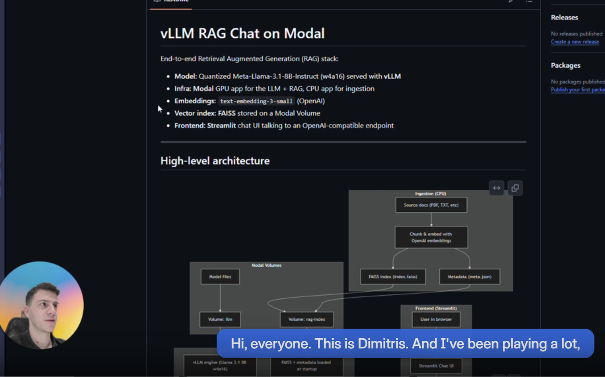
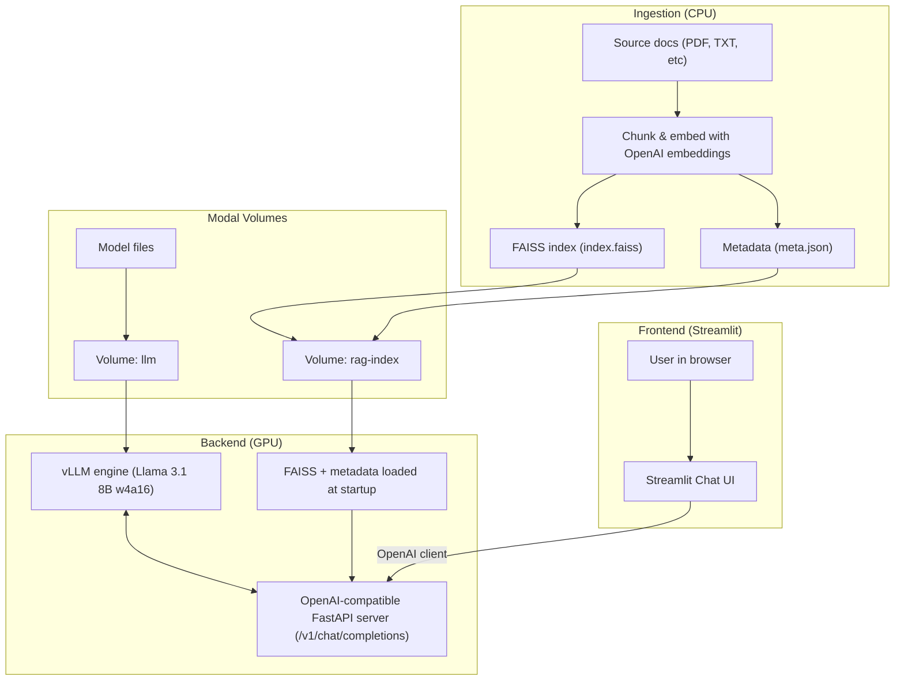

# vLLM RAG Chat on Modal

End-to-end Retrieval Augmented Generation (RAG) stack:

- **Model:** Quantized Meta-Llama-3.1-8B-Instruct (w4a16) served with **vLLM**
- **Infra:** **Modal** GPU app for the LLM + RAG, CPU app for ingestion
- **Embeddings:** `text-embedding-3-small` (OpenAI)
- **Vector index:** **FAISS** stored on a Modal Volume
- **Frontend:** **Streamlit** chat UI talking to an OpenAI-compatible endpoint

---
[Watch the demo ▶️](https://www.loom.com/share/270222a0b6fd4a199e5bf46b1fa71b01)
[](https://www.loom.com/share/270222a0b6fd4a199e5bf46b1fa71b01)

## Beyond the course

Serving the model with vLLM on Modal and the base Streamlit chat UI follow the course this project started from (see Acknowledgements). Everything below was added on top:

- **RAG inside the vLLM server:** a subclass of vLLM's `OpenAIServingChat` retrieves the top-3 FAISS chunks for every `/v1/chat/completions` request and appends them to the latest user message. Any OpenAI-compatible client gets RAG with no client-side changes.
- **Ingestion pipeline:** `rag_ingest.py` splits the docs in `docs/` into 800-character chunks (150 overlap), embeds them with `text-embedding-3-small`, and writes a cosine FAISS index plus metadata to a Modal Volume that the GPU server loads at startup.
- **Personas:** switchable system prompts in the Streamlit sidebar, applied to the conversation in progress.
- **Access control:** Modal proxy auth on the GPU endpoint and a password-gated UI, so the public deployment can't be used to run up GPU cost.

## Numbers

| Metric | Value |
|---|---|
| Model | Llama 3.1 8B Instruct, 4-bit weights (w4a16), vLLM 0.6.3 |
| GPU | 1× NVIDIA T4 (16 GB) |
| Cold start | ~1.5 min to first response (measured) |
| Idle cost | $0: scales to zero after 5 min without requests |
| GPU cost while running | ~$0.59/hr (Modal T4 rate) |
| Typical 15-min demo | ~$0.25, including warm-up and idle tail |
| Scaling | 2 concurrent requests per GPU container; Modal adds containers under load |
| Retrieval cost | Top-3 chunks per question; query embedding ≈ $0.000001 |

## High-level architecture

## Access control

The GPU backend uses Modal [proxy auth](https://modal.com/docs/guide/webhook-proxy-auth), so requests without a token are rejected before they reach it. The Streamlit UI asks for a demo password before it contacts the backend, so a visitor without the password can't wake the GPU.

Both values live in a Modal secret named `demo-auth`. Setup (Modal CLI 1.5.1+):

```bash
modal workspace proxy-tokens create --name demo-ui   # prints "Authorization: Bearer wk-....ws-..."
modal secret create demo-auth MODAL_PROXY_TOKEN=wk-....ws-... DEMO_PASSWORD=<your-password>
modal deploy inferencing.py
modal deploy streamlitserve.py
```

## Acknowledgements

This project was initially inspired by the Udemy course "Production LLM Deployment: vLLM,FastAPI,Modal and AI Chatbot" by Petar Petkanov (Not affiliated or sponsored in any way).
I used it to learn the basics of Modal apps and vLLM, then extended it.


